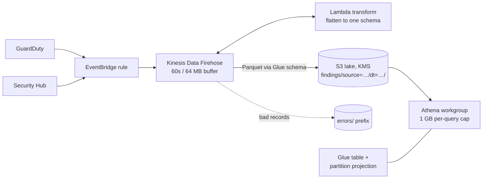

# Security Findings Data Lake (GuardDuty + Security Hub → Parquet → Athena)


Every GuardDuty and Security Hub finding is streamed through EventBridge and Kinesis Data Firehose, flattened by a small Lambda into one common schema, converted to Parquet, and stored in S3 partitioned by source and day. Athena queries it with partition projection, so there is no crawler to run and queries scan only the days they need.

**Problem:** findings age out of consoles (GuardDuty keeps 90 days), cannot be trended, and two services use two different formats. **Outcome:** one queryable table for a year of findings, answering "which controls fail most" or "what HIGH findings hit us this week" in seconds for cents.

## Architecture



## Schema

`finding_id, account_id, region, type, title, severity_label, severity_rank, resource_type, resource_id, control_id, compliance_status, workflow_status, first_seen, last_seen` partitioned by `source` (guardduty, securityhub) and `dt` (yyyy-MM-dd).

## Saved queries

| Query | Question it answers |
| --- | --- |
| `high_critical_last_24h` | What serious findings hit us today? |
| `top_failed_controls` | Which Security Hub controls fail on the most resources this week? |
| `guardduty_by_type` | Which threat types are trending? |
| `noisiest_resources` | Which resources should we fix first? |

## Deploy

Needs GuardDuty and Security Hub enabled (for example by [aws-secure-landing-zone](https://github.com/mk7git-hub/aws-secure-landing-zone)).

```bash
pytest -q                                   # 6 tests
cd infra && cp terraform.tfvars.example terraform.tfvars
terraform init && terraform apply
cd .. && ./demo.sh                          # sample findings → wait 3 min → Athena results
```

## Cost

Pennies at lab volume: Firehose charges per GB ingested plus format conversion, Athena $5 per TB scanned (Parquet plus partitions keep scans tiny; each query is capped at 1 GB), S3 storage with a 400-day expiry, one KMS key.

## Design notes

- Firehose's built-in Parquet conversion instead of a Lambda with pyarrow: no heavy dependency layer to maintain.
- Security Hub sends one finding per EventBridge event. If a multi-finding event ever arrives, the raw event goes to the `errors/` prefix rather than being dropped silently.
- Checkov: 80 passed, 0 failed; 11 documented skips.

Design decisions and trade-offs: [docs/design-decisions.md](docs/design-decisions.md).
